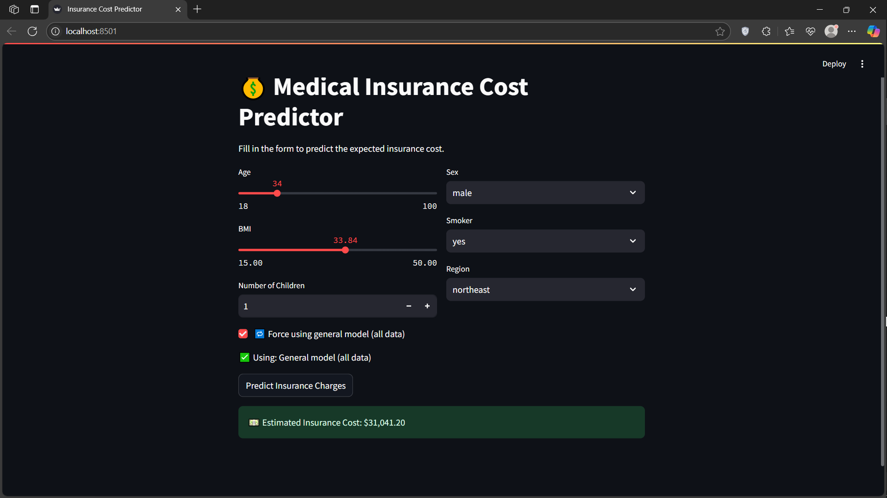

# Medical Insurance Cost Prediction

This educational project uses linear regression to estimate the `charges` field in the Medical Cost Personal Dataset. The Streamlit app selects a model by smoking status and lets you switch to a model trained on the full dataset. Actual insurance quotes depend on the insurer and plan.



## Run locally

Use Python 3.11. Clone the repository and run these commands from its root in your Python environment.

```bash
python -m pip install -r requirements.txt
python -m streamlit run app/main.py
```

Open the local URL printed by Streamlit. The app uses the checked-in model and scaler files in `models/`. The dependency file pins scikit-learn to the version used to save those files.

## Data and training

- [Medical Cost Personal Dataset](https://www.kaggle.com/datasets/mirichoi0218/insurance) · 1,338 rows, included in [data/insurance.csv](data/insurance.csv).
- [Exploratory analysis](notebooks/01_EDA.ipynb) · distributions, relationships with charges, and plots.
- [Model building](notebooks/02_Model_Building.ipynb) · trains and evaluates the three models, then writes model and scaler artifacts. Run the notebook from `notebooks/` to regenerate them.

The models use age, sex, BMI, number of children, smoking status, and region. Each evaluation uses an 80/20 split of its own data. Compare the scores within that context because the three test sets represent different populations.

| Model | MAE | RMSE | R² |
| --- | ---: | ---: | ---: |
| All records | 4,181.19 | 5,796.28 | 0.7836 |
| Smokers | 4,774.73 | 6,697.87 | 0.7010 |
| Non-smokers | 2,422.00 | 4,363.45 | 0.4577 |

The source code is available under the [MIT License](LICENSE).
